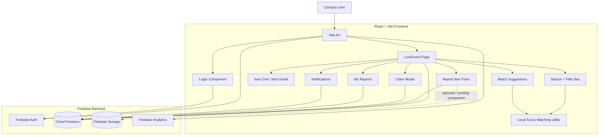

# Campus Connect - High-Level Design Diagram

## Notes

The app is a React + Vite frontend backed by Firebase services. Authentication is handled by Firebase Auth. Lost and found item data is stored in Cloud Firestore. The UI performs search, filtering, and match suggestions locally using the fuzzy matching utility.
